# Faizaan's IBCS Visuals

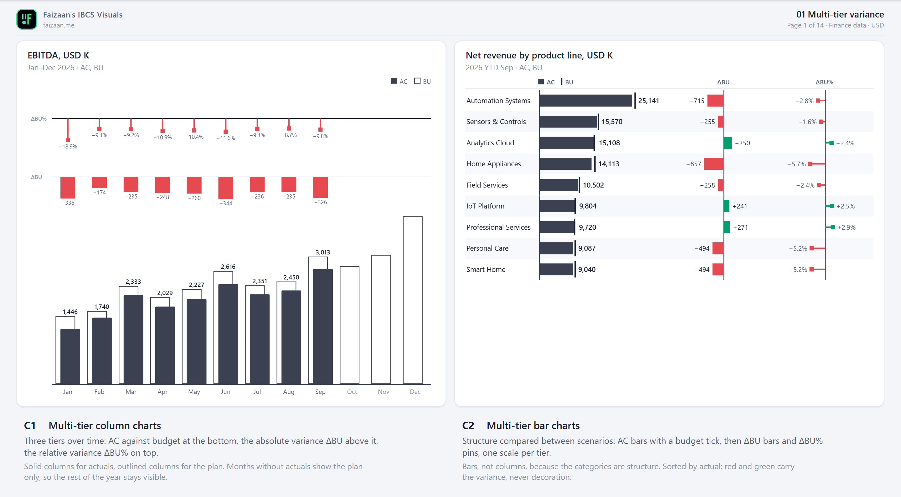

A Power BI report that shows the **IBCS** business-communication notation as working custom visuals: multi-tier column and bar charts, variance waterfalls, stacked charts, lines and areas, scattergrams, bubbles, small multiples, hierarchical tables with integrated bars and waterfalls, KPI cards and a cross table. Everything is built on one fictional finance data set (Contoso Group), so every chart can be checked against the same numbers.

The repository is a **Power BI project (PBIP)**: report and semantic model are plain files (PBIR JSON and TMDL), so they can be read, diffed and versioned. The eight custom visuals the report uses are also here as ready-to-import `.pbiviz` files.

> IBCS® is a registered trademark of the IBCS Association. This project follows the published IBCS chart and table templates but is not affiliated with, endorsed by or certified by the IBCS Association.

## Contents

- [Quick start](#quick-start)
- [What is in the repository](#what-is-in-the-repository)
- [The eight custom visuals](#the-eight-custom-visuals)
- [The charts, page by page](#the-charts-page-by-page)
- [IBCS template coverage](#ibcs-template-coverage)
- [About the data](#about-the-data)
- [How to read the notation](#how-to-read-the-notation)
- [Limits](#limits)
- [Licence and contact](#licence-and-contact)

## Quick start

You need Power BI Desktop with the enhanced report format (PBIR) available, a recent build.

1. Clone or download the repository. Keep the folder path short: Power BI cannot open a project whose file paths reach 260 characters, and the embedded visuals already add about 140.
2. Open `IBCS.pbip` in Power BI Desktop. The report opens empty, because the data is not loaded yet.
3. Point the model at the CSV files: **Home > Transform data > Manage parameters**, set `DataFolder` to the full path of the `data` folder **with a trailing backslash**, for example `C:\Projects\ibcs-visuals\data\`. Close the editor and **Apply changes**.
4. **Home > Refresh**. All 14 pages now fill with data.

To use one of the visuals in your own report instead, open **Visualizations > ... > Import a visual from a file** and pick the `.pbiviz` from its folder under [`visuals/`](visuals).

## What is in the repository

```
IBCS.pbip                    project entry point
IBCS.Report/                 the report: 14 pages, embedded custom visuals, theme, page backgrounds
IBCS.SemanticModel/          the data model (TMDL): tables, relationships, measures, DataFolder parameter
data/                        13 CSV files with the fictional Contoso finance data
visuals/<name>/<name>.pbiviz one folder per custom visual, with a short README
images/                      the pictures used on this page
```

## The eight custom visuals

Every visual is also embedded in `IBCS.Report/CustomVisuals/`, so the report works without importing anything.

| Folder | Visual | Draws |
| --- | --- | --- |
| [`finVarianceChart`](visuals/finVarianceChart) | IBCS Period Chart | Columns, lines or areas over time with a budget, prior-year or forecast comparison, variance tiers (bars, pins, waterfall), integrated variance columns, hills and valleys, forecast segments and a secondary line |
| [`finVarianceBars`](visuals/finVarianceBars) | IBCS Variance Bars | Structure bars with a comparison tick, absolute variance, relative variance pins, optional waterfall with total, Top N + Others, axis break |
| [`finVarianceTable`](visuals/finVarianceTable) | IBCS Statement Table | Hierarchical tables with expandable rows, running results, margin rows, variances as numbers, bars or a waterfall, and a cross-tab by period |
| [`finWaterfall`](visuals/finWaterfall) | IBCS Bridge Chart | Profit cascade, comparison and actual cascades side by side, plan-to-actual bridge, opening-to-closing balance bridge, cumulative waterfall over periods |
| [`ibcsSeries`](visuals/ibcsSeries) | IBCS Series Chart | Stacked columns, stacked bars, lines, stacked areas and dot plots |
| [`ibcsScatter`](visuals/ibcsScatter) | IBCS Scatter Chart | Scattergram and bubble chart with iso-lines (curves of constant product) |
| [`ibcsMultiples`](visuals/ibcsMultiples) | IBCS Small Multiples | Grid of identical mini charts on one shared scale |
| [`ibcsCards`](visuals/ibcsCards) | IBCS KPI Cards | KPI cards with value, absolute and relative variance and a sparkline |

All eight declare no special privileges (no network access). Clicking a mark is built to cross-filter the page, with Ctrl or Shift adding to the selection.

## The charts, page by page

Each chart below is a custom visual bound to the model's measures. `AC` is actual, `BU` budget, `PY` prior year and `FC` forecast. Unless a chart says otherwise it shows the period **year to date September 2026** against **budget**.

### Page 1: Multi-tier variance

**C03, Multi-tier column charts** (`finVarianceChart`)

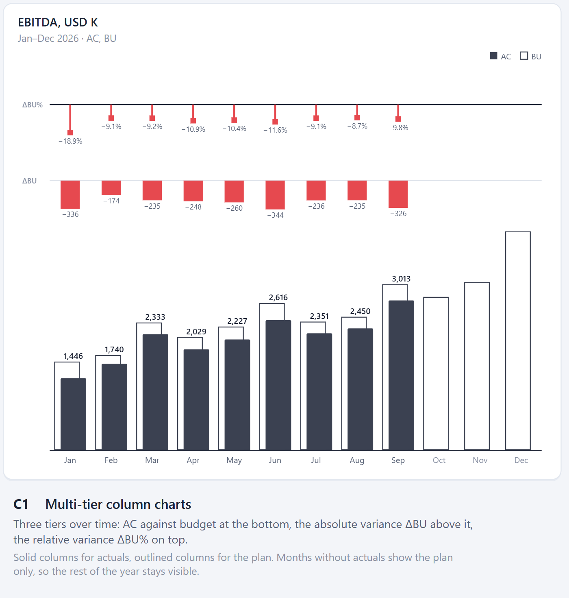

EBITDA by month for 2026 in three tiers: AC against budget at the bottom, the absolute variance ΔBU above it and the relative variance ΔBU% on top. Solid columns are actuals, outlined columns are the plan; months without actuals (October to December) show the plan only, so the rest of the year stays visible.
Fields: `Calendar[Month Start]`, `_Measures[EBITDA Monthly AC]`, `[EBITDA Monthly PM]`, `[Comparison Code]`.

**C04, Multi-tier bar charts** (`finVarianceBars`)

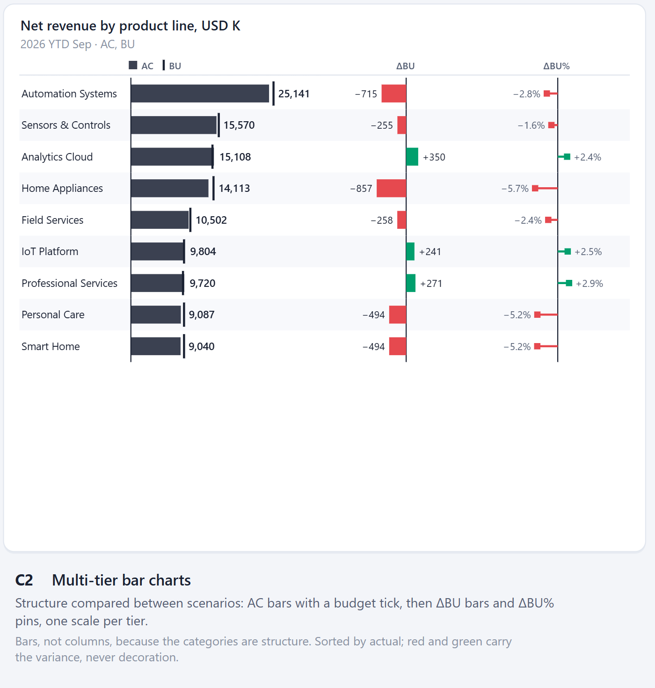

Net revenue by product line. Structure runs down the vertical axis, so these are bars: AC bars with a black budget tick, then ΔBU bars and ΔBU% pins, each tier on its own single scale. Sorted by actual.
Fields: `Product[Product Line]`, `_Measures[Net Revenue AC]`, `[Net Revenue PM]`.

### Page 2: Variance waterfalls

**C05, Columns with horizontal waterfall** (`finVarianceChart`)

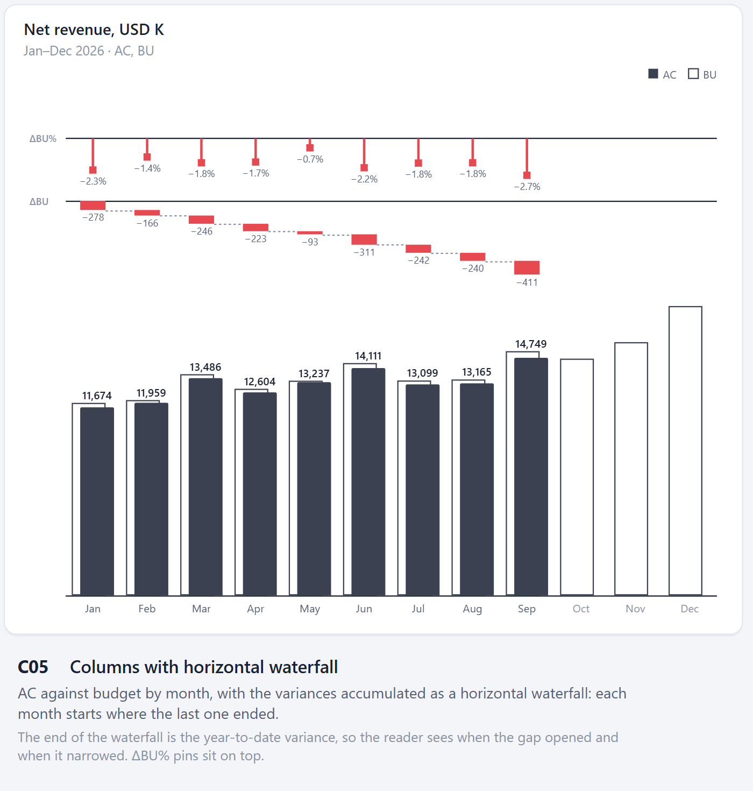

Net revenue by month against budget. The variance tier is a horizontal waterfall: each month's ΔBU starts where the previous month ended, so the last step is the year-to-date variance and the reader sees when the gap opened.
Fields: `Calendar[Month Start]`, `_Measures[Net Revenue Monthly AC]`, `[Net Revenue Monthly PM]`.

**C06, Bars with vertical waterfall** (`finVarianceBars`)

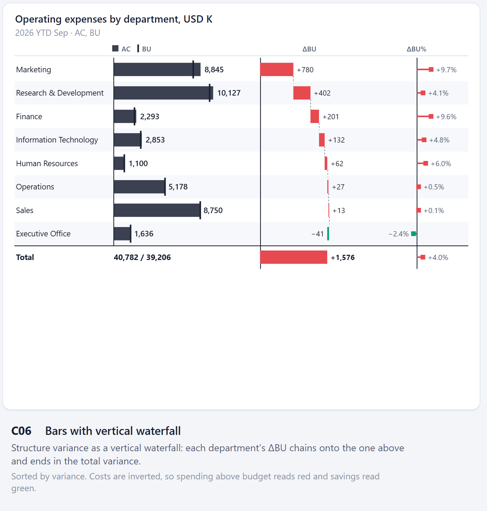

Operating expenses by department. The ΔBU column chains from row to row and ends in a total row. Costs are inverted: spending above budget is red, savings are green. Sorted by variance.
Fields: `Department[Department]`, `_Measures[OPEX AC]`, `[OPEX PM]`.

### Page 3: Lines and areas

**C07, Line charts** (`ibcsSeries`)

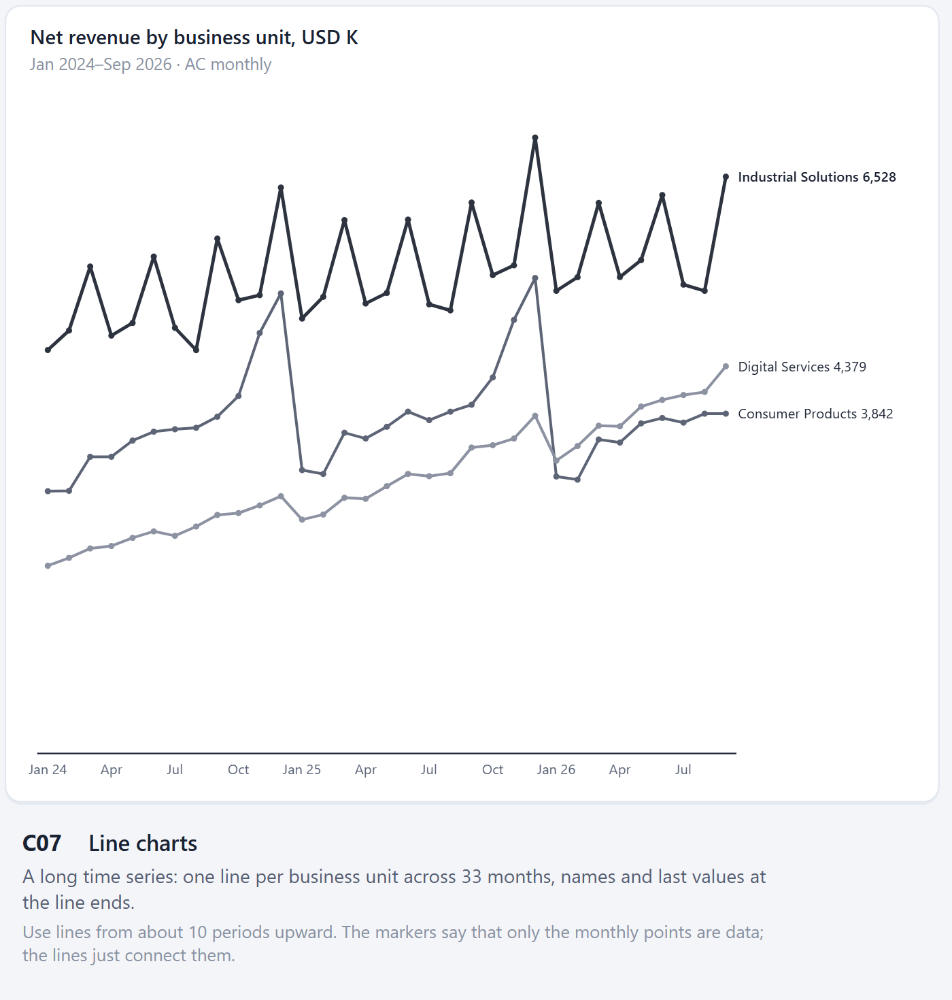

Net revenue by business unit over 33 months (January 2024 to September 2026), one line per unit, series names and last values at the line ends instead of a legend. Lines suit series of about ten periods or more.
Fields: `Calendar[Month Start]`, `BusinessUnit[Business Unit]`, `_Measures[Net Revenue Monthly AC]`.

**C08, Area charts** (`ibcsSeries`)

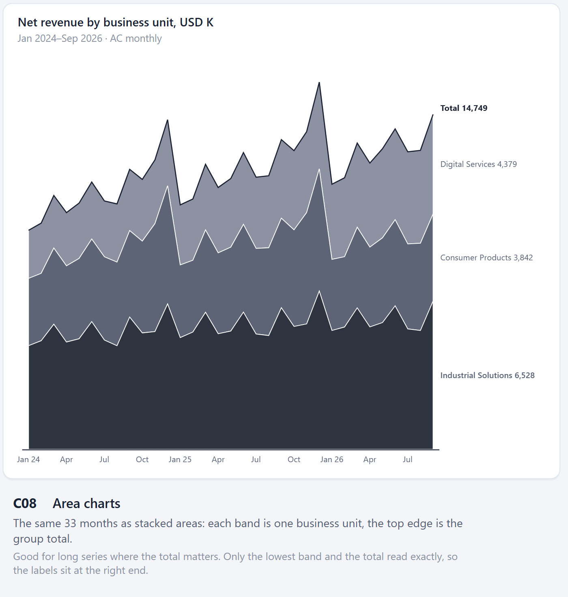

The same 33 months as stacked areas: each band is one business unit, the top edge is the group total. Only the lowest band and the total can be read exactly.
Fields: as C07.

### Page 4: Scatter and bubble

**C09, Scattergrams** (`ibcsScatter`)

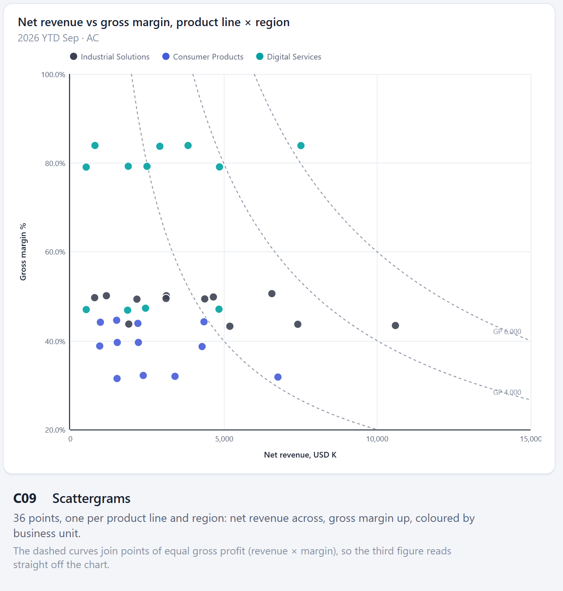

36 points, one per product line and region: net revenue across, gross margin up, coloured by business unit. The dashed curves join points of equal gross profit (revenue × margin), so a third figure can be read straight off the chart.
Fields: `Product[Product Line]`, `Region[Region]`, `Product[Product BU]`, `_Measures[Net Revenue AC]`, `[Gross Margin % AC]`.

**C10, Bubble charts** (`ibcsScatter`)

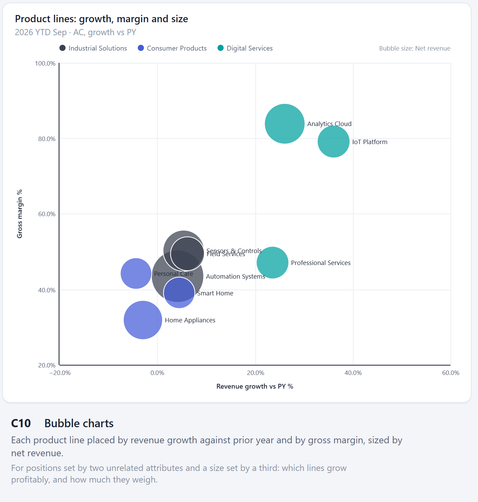

Each product line placed by revenue growth against prior year and by gross margin, sized by net revenue: which lines grow profitably and how much they weigh.
Fields: `Product[Product Line]`, `_Measures[Revenue Growth % AC]`, `[Gross Margin % AC]`, `[Net Revenue AC]`.

### Page 5: Waterfall and small multiples

**C12, Vertical waterfalls** (`finWaterfall`)

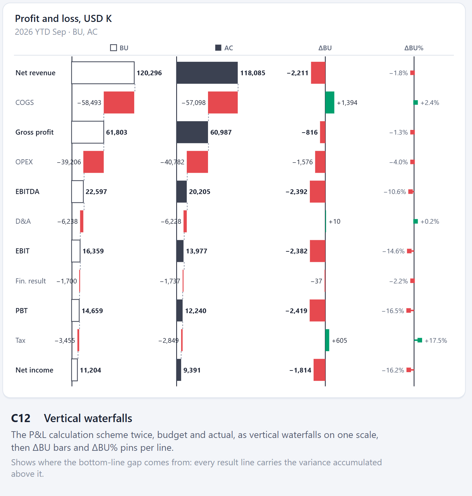

The profit-and-loss calculation scheme twice, budget and actual, as waterfalls on one scale, then ΔBU bars and ΔBU% pins per line. Every result line (gross profit, EBITDA, EBIT, profit before tax, net income) carries the variance accumulated above it.
Fields: `Account[Line Short]`, `Account[Class Short]`, `_Measures[Amount AC]`, `[Amount PM]`.

**C13, Small multiples** (`ibcsMultiples`)

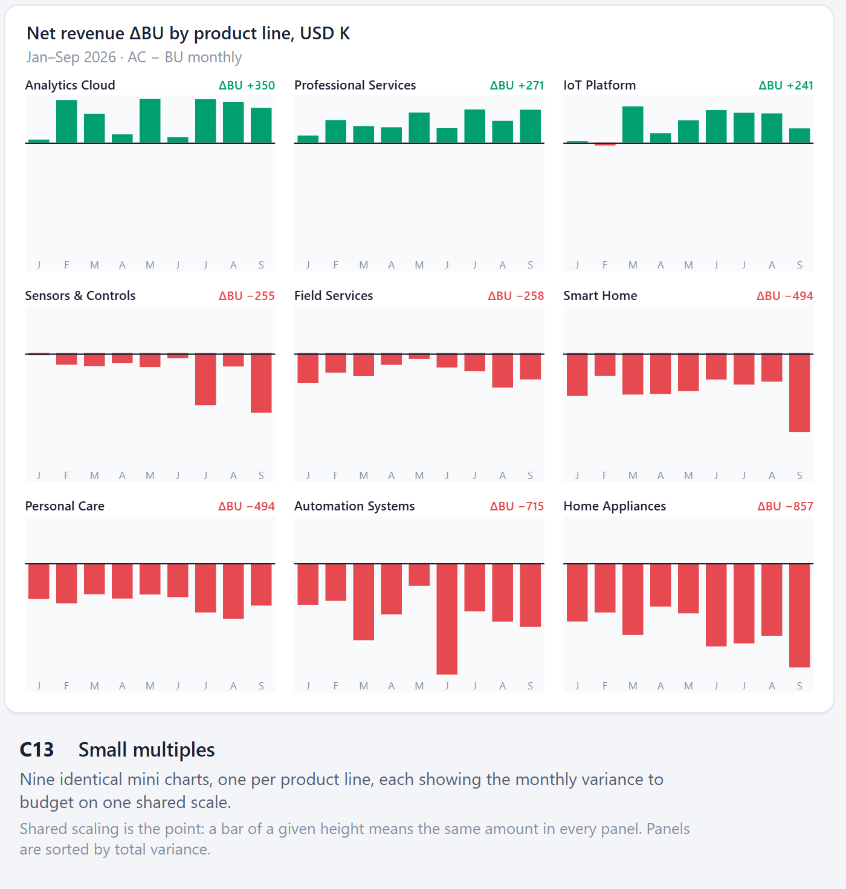

Nine identical mini charts, one per product line, each showing the monthly net revenue variance to budget on one shared scale, so a bar of a given height means the same amount in every panel. Panels are sorted by total variance.
Fields: `Product[Product Line]`, `Calendar[Month Start]`, `_Measures[Net Revenue Monthly AC]`, `[Net Revenue Monthly PM]`.

### Page 6: Table T01

**T01, Table with hierarchical rows and variance columns** (`finVarianceTable`)

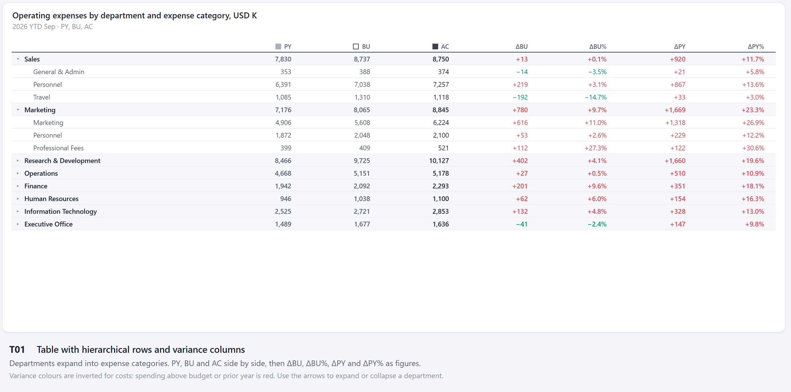

Operating expenses by department, expanding into expense categories. PY, BU and AC side by side, then ΔBU, ΔBU%, ΔPY and ΔPY% as figures. Colours are inverted for costs; the arrows expand and collapse a department.
Fields: `Department[Department]`, `Account[Expense Category]`, `_Measures[OPEX AC]`, `[OPEX PM]`, `[OPEX PY]`.

### Page 7: Table T02

**T02, Table with hierarchical rows and integrated bar charts** (`finVarianceTable`)

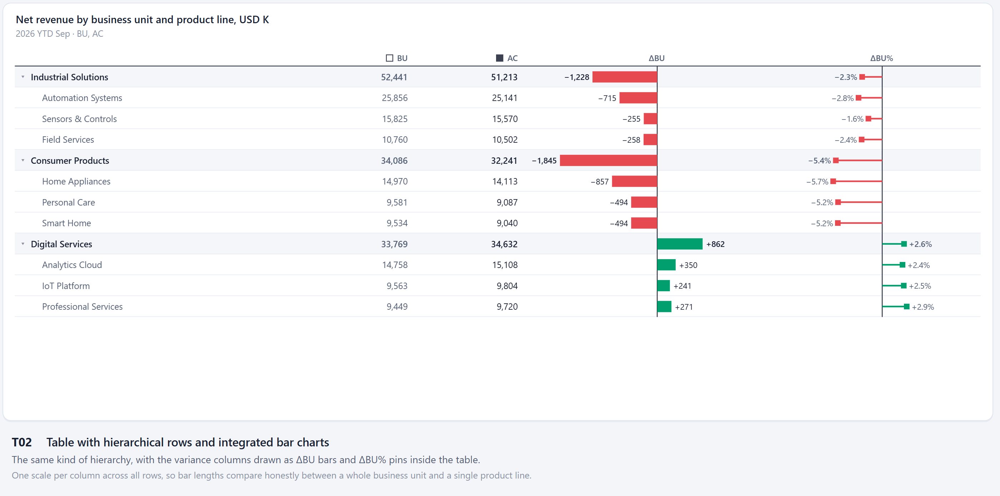

Net revenue by business unit and product line, with the variance columns drawn as ΔBU bars and ΔBU% pins inside the table. One scale per column across all rows, so a business-unit bar and a product-line bar compare honestly.
Fields: `BusinessUnit[Business Unit]`, `Product[Product Line]`, `_Measures[Net Revenue AC]`, `[Net Revenue PM]`.

### Page 8: Table T03

**T03, Table with measure rows** (`finVarianceTable`)

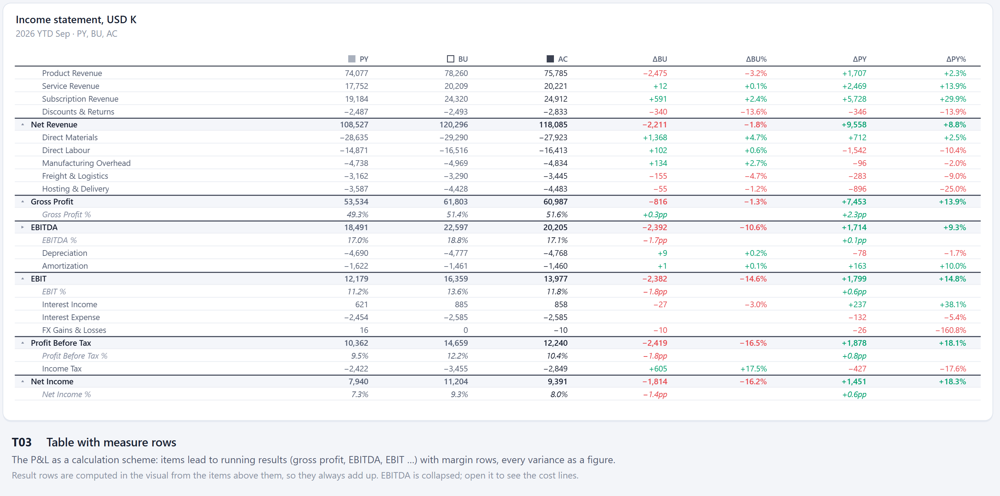

The income statement as a calculation scheme: items lead to running results (net revenue, gross profit, EBITDA, EBIT, profit before tax, net income) with margin rows in italics and every variance as a figure. Result rows are computed in the visual from the items above them, so they always add up.
Fields: `Account[Statement Line]`, `Account[Account]`, `_Measures[Amount AC]`, `[Amount PM]`, `[Amount PY]`.

### Page 9: Table T04

**T04, Table with measure rows and integrated waterfalls** (`finVarianceTable`)

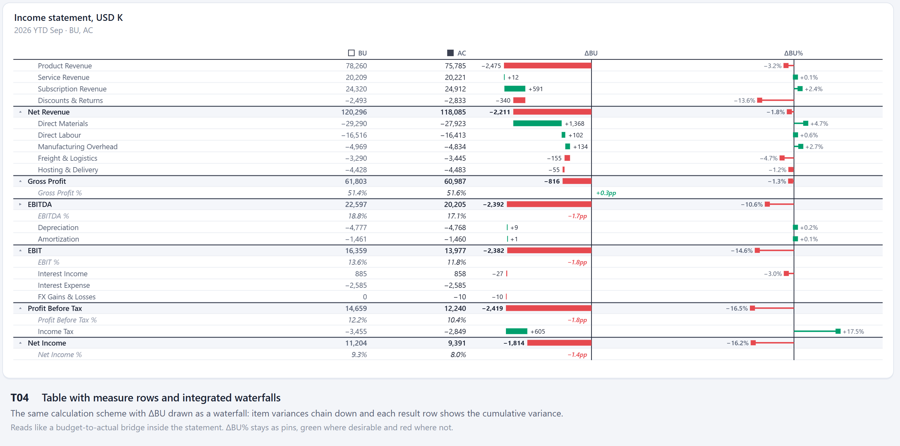

The same calculation scheme with ΔBU drawn as bars next to the figures and ΔBU% as pins, green where desirable and red where not.
Fields: `Account[Statement Line]`, `Account[Account]`, `_Measures[Amount AC]`, `[Amount PM]`.

### Page 10: Integrated variance and hills and valleys

**Integrated variance columns** (`finVarianceChart`)

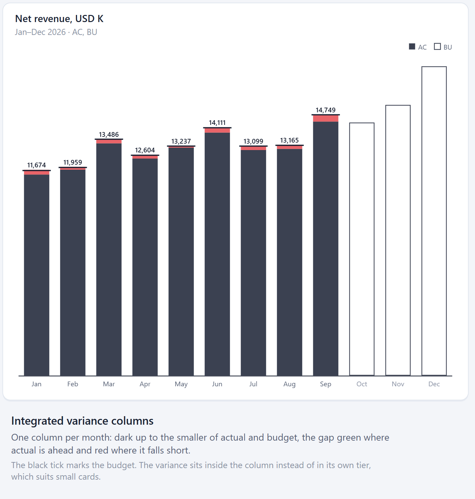

One column per month: dark up to the smaller of actual and budget, the gap drawn inside the column, red where actual falls short of the budget and green where it is ahead. The black tick marks the budget. The variance sits in the column instead of in its own tier, which suits small cards.
Fields: `Calendar[Month Start]`, `_Measures[Net Revenue Monthly AC]`, `[Net Revenue Monthly PM]`.

**Hills and valleys** (`finVarianceChart`)

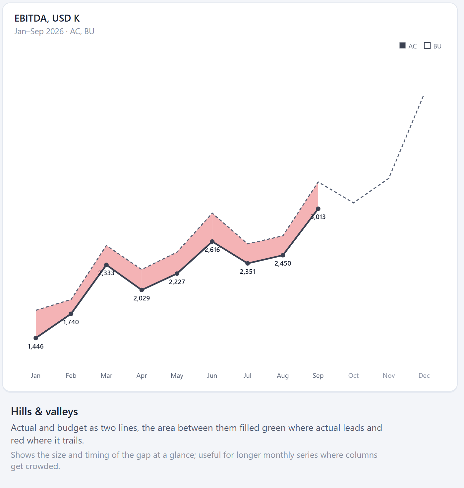

EBITDA actual and budget as two lines, the area between them filled green where actual leads and red where it trails. Shows the size and timing of the gap at a glance.
Fields: `Calendar[Month Start]`, `_Measures[EBITDA Monthly AC]`, `[EBITDA Monthly PM]`.

### Page 11: Forecast and combo

**Segmented actual and forecast** (`finVarianceChart`)

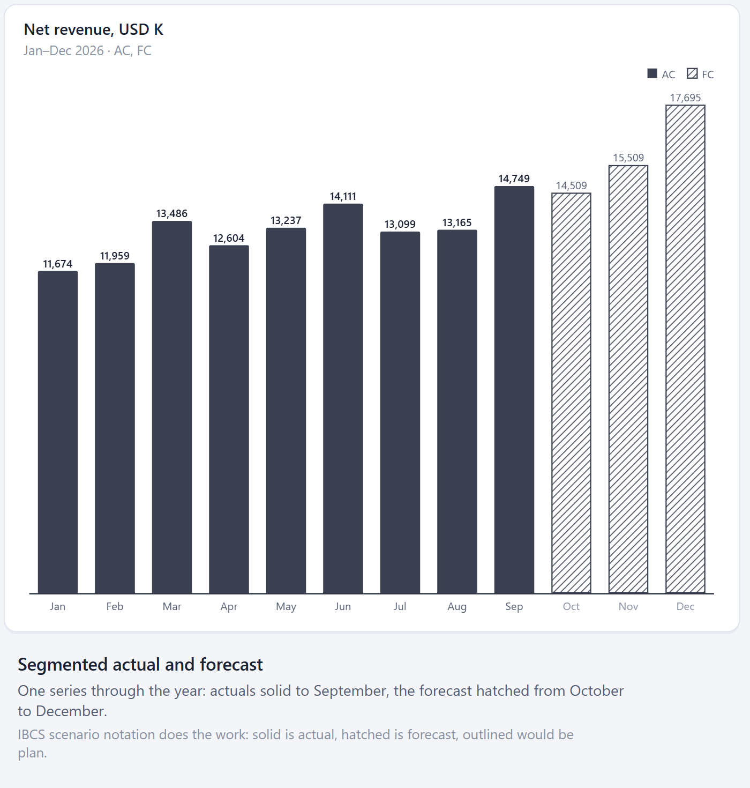

Net revenue as one series through the year: actuals solid until September, the forecast hatched from October to December.
Fields: `Calendar[Month Start]`, `_Measures[Net Revenue Monthly AC]`, `[Net Revenue Monthly FC]`, `[Scenario FC]`.

**Combo chart** (`finVarianceChart`)

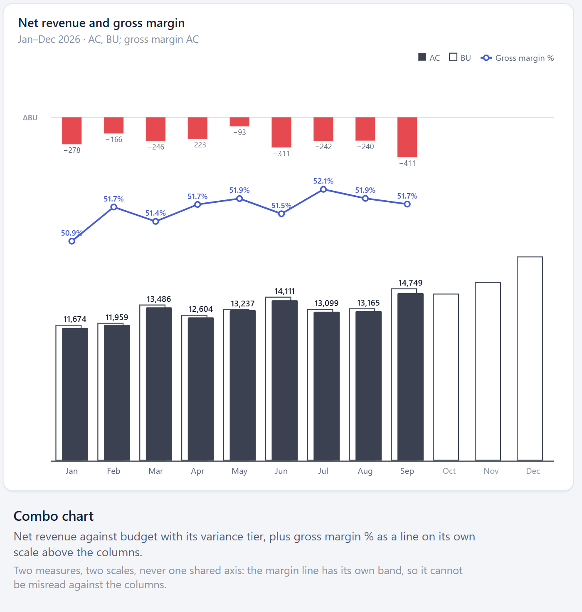

Net revenue against budget with its ΔBU tier, plus gross margin % as a line on its own scale above the columns. Two measures, two scales: the margin line has its own band, so it cannot be misread against the columns.
Fields: `Calendar[Month Start]`, `_Measures[Net Revenue Monthly AC]`, `[Net Revenue Monthly PM]`, `[Gross Margin % Monthly AC]`.

### Page 12: Dots and period waterfall

**Dot plot (lollipop)** (`ibcsSeries`)

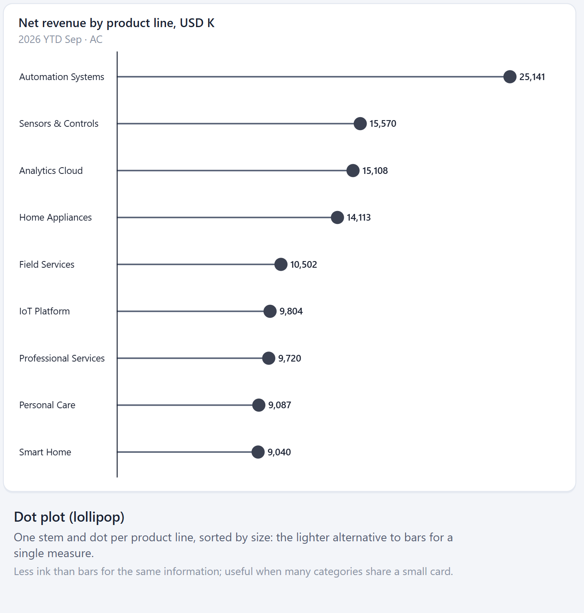

Net revenue by product line as one stem and dot per category, sorted by size. Less ink than bars for the same information.
Fields: `Product[Product Line]`, `_Measures[Net Revenue AC]`.

**Waterfall over time** (`finWaterfall`)

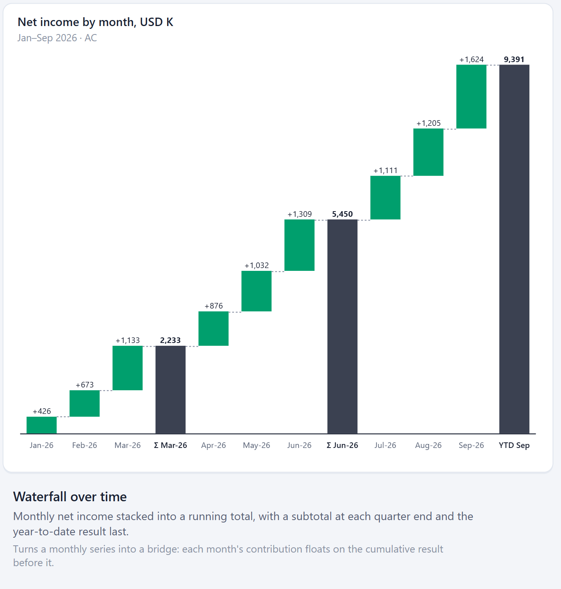

Monthly net income stacked into a running total, with a subtotal at each quarter end and the year-to-date result last. Each month's contribution floats on the cumulative result before it.
Fields: `Calendar[Month Start]`, `_Measures[Net Income Monthly AC]`.

### Page 13: Stacked charts

**C01, Stacked column charts** (`ibcsSeries`)

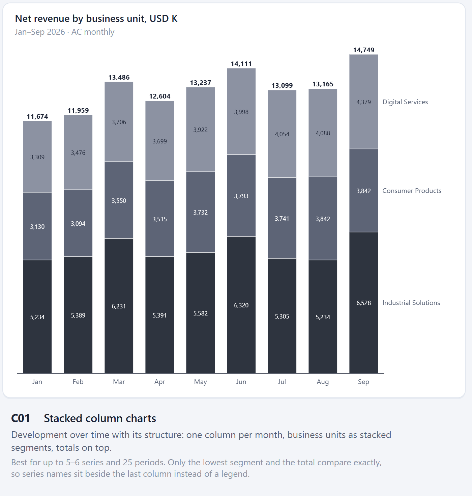

Net revenue by business unit, January to September 2026: one column per month, business units as stacked segments, totals on top. Series names sit beside the last column instead of in a legend.
Fields: `Calendar[Month Start]`, `BusinessUnit[Business Unit]`, `_Measures[Net Revenue Monthly AC]`.

**C02, Stacked bar charts** (`ibcsSeries`)

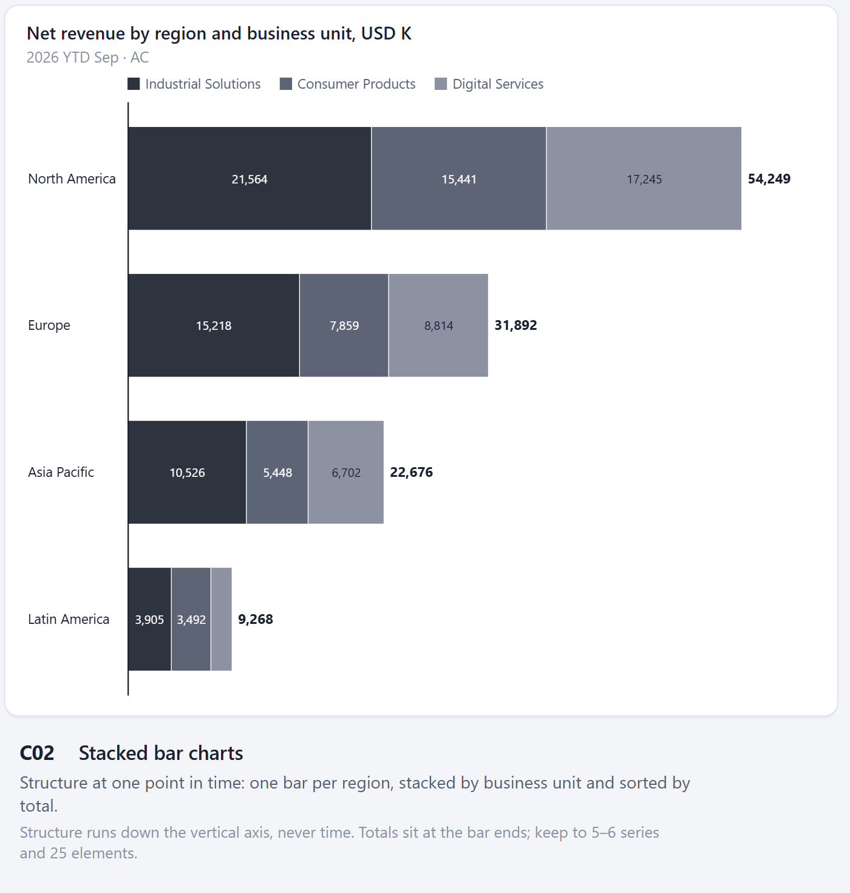

Structure at one point in time: net revenue by region, stacked by business unit, sorted by total, with the totals at the bar ends and the legend above.
Fields: `Region[Region]`, `BusinessUnit[Business Unit]`, `_Measures[Net Revenue AC]`.

### Page 14: KPI cards and cross table

**KPI cards** (`ibcsCards`)

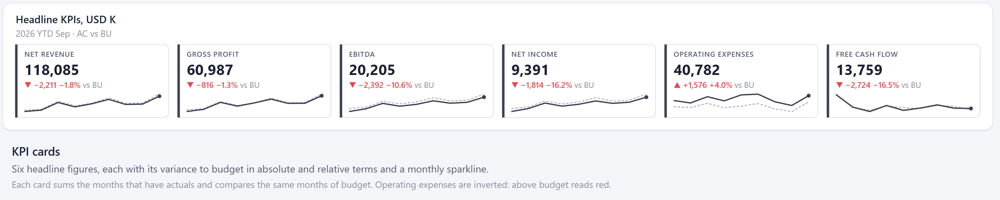

Six headline figures (net revenue, gross profit, EBITDA, net income, operating expenses, free cash flow), each with its variance to budget in absolute and relative terms and a monthly sparkline with the budget dashed. Operating expenses are inverted: above budget reads red.
Fields: `Calendar[Month Start]`, six `_Measures[... Monthly AC]` and six `[... Monthly PM]` measures.

**Cross table with integrated variances** (`finVarianceTable`)

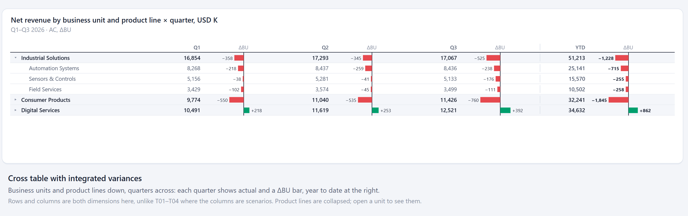

Business units and product lines down, quarters across: each quarter shows the actual and a ΔBU bar, year to date at the right. Rows and columns are both dimensions here, unlike T01 to T04 where the columns are scenarios. Product lines are collapsed under their unit; open a unit to see them.
Fields: `BusinessUnit[Business Unit]`, `Product[Product Line]`, `Calendar[Quarter]`, `_Measures[Net Revenue Monthly AC]`, `[Net Revenue Monthly PM]`.

## IBCS template coverage

The IBCS Association publishes 13 chart templates (C01 to C13) and 4 table templates (T01 to T04). The captions on the report pages number the charts in reading order (C1 to C12) and keep T01 to T04 for the tables; the table below maps them to the official IBCS codes. This report builds 16 of the 17, plus eight further forms the templates do not name.

| Template | Name | Caption on the page | Where |
| --- | --- | --- | --- |
| C01 | Stacked column charts | C11 | Page 13 |
| C02 | Stacked bar charts | C12 | Page 13 |
| C03 | Multi-tier column charts | C1 | Page 1 |
| C04 | Multi-tier bar charts | C2 | Page 1 |
| C05 | Columns with horizontal waterfall charts | C3 | Page 2 |
| C06 | Bars with vertical waterfall charts | C4 | Page 2 |
| C07 | Line charts | C5 | Page 3 |
| C08 | Area charts | C6 | Page 3 |
| C09 | Scattergrams | C7 | Page 4 |
| C10 | Bubble charts | C8 | Page 4 |
| C11 | Tree charts | not in this report | not in this report |
| C12 | Vertical waterfalls | C9 | Page 5 |
| C13 | Small multiples | C10 | Page 5 |
| T01 | Table with hierarchical rows and variance columns | T01 | Page 6 |
| T02 | Table with hierarchical rows and integrated bar charts | T02 | Page 7 |
| T03 | Table with measure rows | T03 | Page 8 |
| T04 | Table with measure rows and integrated waterfalls | T04 | Page 9 |

Further forms: integrated variance columns and hills and valleys (page 10), segmented actual and forecast and a combo chart (page 11), a dot plot and a waterfall over time (page 12), KPI cards and a cross table (page 14).

## About the data

The data is **fictional**: Contoso Group, a company with three business units (Industrial Solutions, Consumer Products, Digital Services), four regions, nine product lines and eight departments, generated for this project. No real company, customer or person is in it.

| Table group | Tables |
| --- | --- |
| Facts | `FactPL` (profit and loss), `FactBS` (balance sheet), `FactCF` (cash flow), `FactHeadcount` |
| Dimensions | `Calendar`, `Account`, `BSAccount`, `CFLine`, `BusinessUnit`, `Region`, `Product`, `SalesChannel`, `Department` |
| Selectors | `ViewSelector` (YTD, QTD, MTD), `ComparisonSelector` (Budget, Prior Year, Forecast) |
| Measures | `_Measures` holds the business measures (AC, PM, BU, PY, FC, margins, ratios), each with a description |

Actuals run from January 2024 to September 2026 (the last closed month); budget and forecast run to December 2026. With no slicers on the pages the measures resolve to year to date September 2026 against budget. Costs are stored as negative amounts, so a positive variance is always favourable on the profit and loss pages.

## How to read the notation

| Mark | Meaning |
| --- | --- |
| Solid dark | Actual (AC) |
| Outlined | Budget or plan (BU) |
| Hatched | Forecast (FC) |
| Solid light grey | Previous year (PY) |
| Green and red | Favourable and unfavourable variance; costs are inverted so overspend is red |
| Pin (line with square head) | Relative variance |
| Time on the horizontal axis, structure on the vertical | The IBCS rule for choosing between columns and bars |

## Limits

- The pictures are single frames. Tooltips, cross-filtering and expanding or collapsing table rows are built into the visuals but are not shown here.
- Months without actuals show the comparison only, by design.
- The report uses number formats that follow IBCS practice (thousands, one-decimal percentages) rather than the whole-number style of a typical dashboard.
- The tree chart (C11) is not part of this report.

## Licence and contact

MIT, see [`LICENSE`](LICENSE). Built by Faizaan Fareed, [faizaan.me](https://faizaan.me), Contact@faizaan.me.
