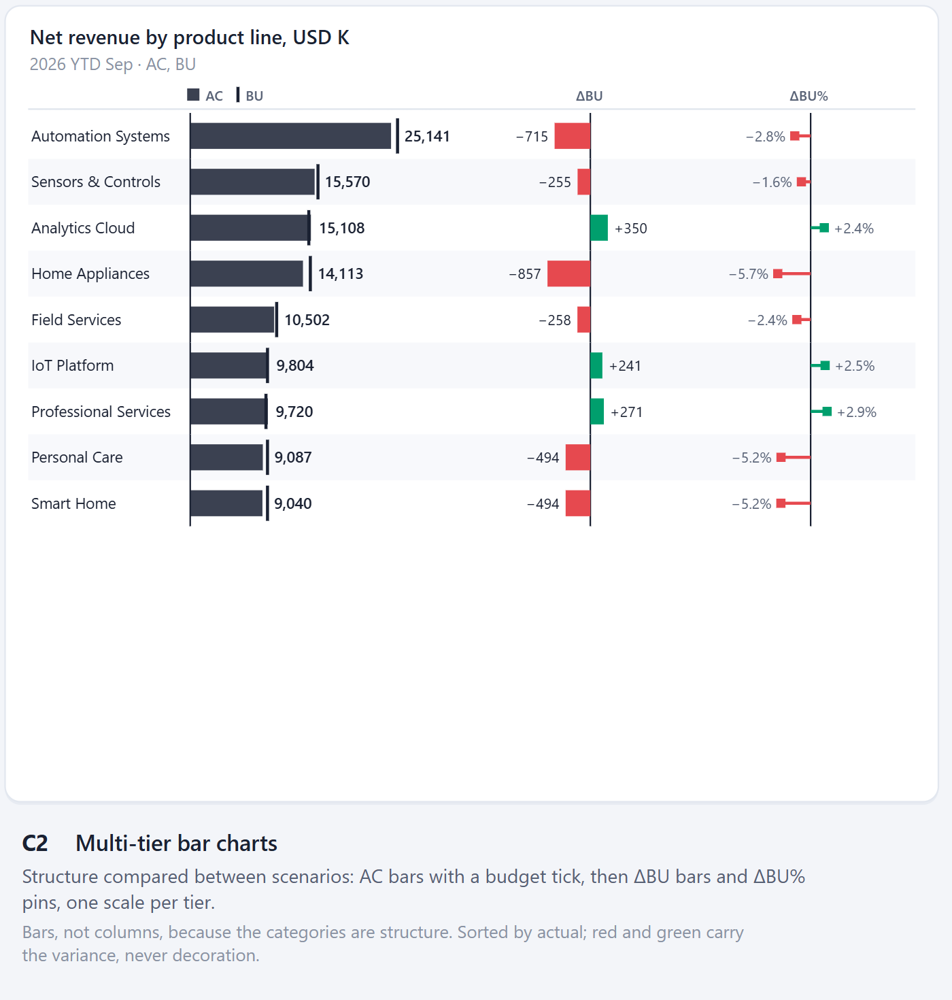

# IBCS Variance Bars

IBCS horizontal bar chart: actual with comparison marker, absolute and relative variances.

Used in the report on: Pages 1 and 2 (C04, C06).

## Install

In Power BI Desktop: **Visualizations > ... > Import a visual from a file**, then pick `finVarianceBars.pbiviz`.

## Data roles

| Role | Field type | Notes |
| --- | --- | --- |
| Category (`category`) | Grouping |  |
| Actual (AC) (`ac`) | Measure |  |
| Comparison (BU / PY / FC) (`pm`) | Measure |  |
| Comparison label (text measure) (`pmName`) | Measure |  |

## Format options

- **Display**: Unit, Text size, Sort by, Max rows (0 = all), Relative variance column, Invert variance colours (costs), Actual label, Comparison label, Label width (0 = auto), Variance column, Top N + Others (0 = off), Others label, Total label, Axis break for an outlier
- **Colours**: Actual, Positive variance, Negative variance

## Details

- Version 1.0.0.2, visual GUID `finVarianceBarsE91363896AE34AE2A96AE99E545CB2A2`
- No special privileges (no network access)
- Author: Faizaan, Contact@faizaan.me
- Licence: MIT, see the repository `LICENSE`
