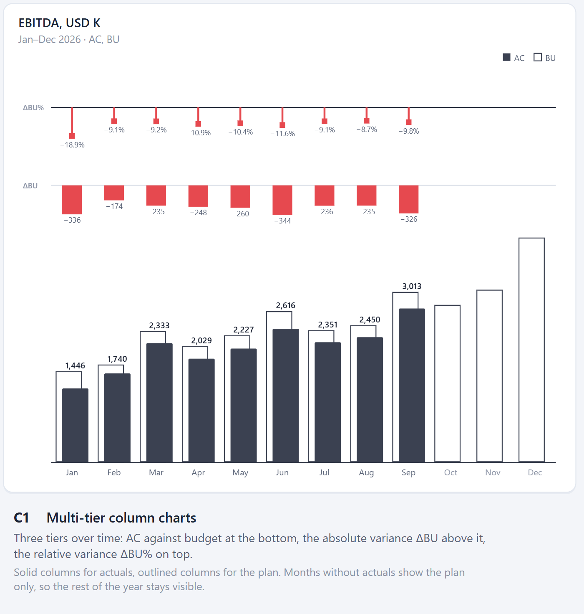

# IBCS Period Chart

IBCS period chart: actual vs comparison scenario with variance strip.

Used in the report on: Pages 1, 2, 10, 11 (C03, C05, integrated variance columns, hills and valleys, segmented actual and forecast, combo).

## Install

In Power BI Desktop: **Visualizations > ... > Import a visual from a file**, then pick `finVarianceChart.pbiviz`.

## Data roles

| Role | Field type | Notes |
| --- | --- | --- |
| Period (`category`) | Grouping |  |
| Value (AC) (`measure`) | Measure |  |
| Comparison (BU / PY / FC) (`pm`) | Measure | Optional. When bound the variance tiers show AC minus the comparison, and the comparison is drawn behind the actuals. |
| Comparison label (text measure) (`pmName`) | Measure | Optional text measure returning the scenario code (BU, PY, FC). |
| Secondary measure (combo line) (`secondary`) | Measure | Optional. Drawn as a line on its own scale above the main plot. |

## Format options

- **Chart**: Type, Column layout, Value format, Variance tier, Variance tier style, Relative variance tier, Actual, then comparison (segmented), Data labels, Scenario legend, Hide blank periods, Text size, Invert variance colours, Actual label, Comparison label, Secondary format
- **Colours**: Actual, Positive variance, Negative variance, Line / area

## Details

- Version 1.0.0.2, visual GUID `finVarianceChartA5D6C9DF32014AF78ED46AC9EC460877`
- No special privileges (no network access)
- Author: Faizaan, Contact@faizaan.me
- Licence: MIT, see the repository `LICENSE`
