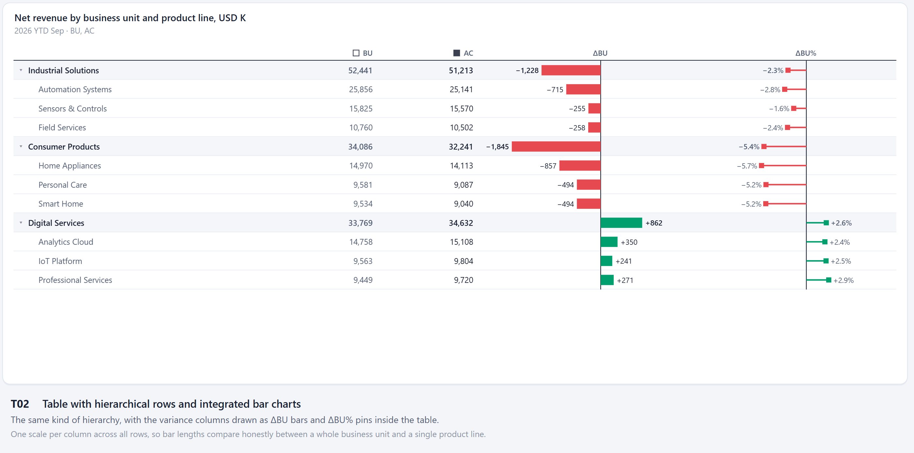

# IBCS Statement Table

IBCS statement table: variance and cross-tab layouts, running results, ratio rows.

Used in the report on: Pages 6, 7, 8, 9 and 14 (T01, T02, T03, T04, cross table).

## Install

In Power BI Desktop: **Visualizations > ... > Import a visual from a file**, then pick `finVarianceTable.pbiviz`.

## Data roles

| Role | Field type | Notes |
| --- | --- | --- |
| Rows (hierarchy, outer to inner) (`rows`) | Grouping |  |
| Row order (one index per level) (`rowOrder`) | Grouping | Optional index columns, in the same order as Rows. Rows sort by these instead of alphabetically. |
| Period (cross-tab columns) (`period`) | Grouping | Optional. When bound the table shows one column per period plus a total. |
| Actual (AC) (`ac`) | Measure |  |
| Comparison (BU / PY / FC) (`pm`) | Measure |  |
| Comparison label (text measure) (`pmName`) | Measure | Optional text measure returning the scenario code (BU, PY, FC). Overrides the Comparison label setting. |
| Prior year (PY) (`py`) | Measure | Optional. Adds a PY column and PY variances in the Numbers layout. |

## Format options

- **Statement**: Group totals, Result row position, Ratio rows (% of first group), Ratio row suffix, Collapsed groups (pipe separated), Hide empty rows, Variance colours, Variance columns
- **Display**: Unit, Text size, Row height, Actual label, Comparison label, Total column (cross-tab), Total column label, Prior year label
- **Colours**: Positive variance, Negative variance, Accent

## Details

- Version 1.0.0.2, visual GUID `finVarianceTable110350F4FE3C462DB9780C576BB24F2D`
- No special privileges (no network access)
- Author: Faizaan, Contact@faizaan.me
- Licence: MIT, see the repository `LICENSE`
