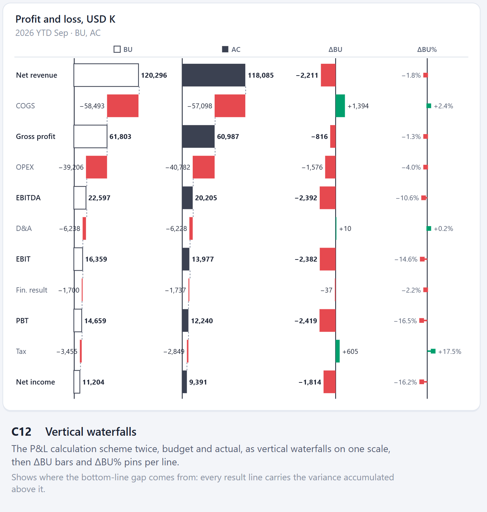

# IBCS Bridge Chart

IBCS waterfall: profit cascade, plan-to-actual variance bridge and cash bridge.

Used in the report on: Pages 5 and 12 (C12, waterfall over time).

## Install

In Power BI Desktop: **Visualizations > ... > Import a visual from a file**, then pick `finWaterfall.pbiviz`.

## Data roles

| Role | Field type | Notes |
| --- | --- | --- |
| Steps (group, then item) (`rows`) | Grouping | One or two levels. In cascade mode the first level holds the result names (e.g. Gross Profit) and the second the items that lead to them. |
| Step order (one index per level) (`rowOrder`) | Grouping |  |
| Value (AC) (`value`) | Measure |  |
| Comparison (variance bridge) (`pm`) | Measure | Optional. When bound the chart bridges from the comparison total to the actual total. |
| Opening balance (balance bridge) (`start`) | Measure | Optional. When bound the chart bridges from the opening balance through the flows to the closing balance. |
| Comparison label (text measure) (`pmName`) | Measure |  |

## Format options

- **Bridge**: Mode, Detail, Orientation, First group as a total, Opening label, Closing label, Actual label, Comparison label, Connectors, Hide zero steps, Subtotal every N periods (0 = none)
- **Display**: Unit, Text size, Label width (bars, 0 = auto)
- **Colours**: Increase, Decrease, Totals

## Details

- Version 1.0.0.3, visual GUID `finWaterfall7603FD2D59F44F1DAE4A9FDD2D503191`
- No special privileges (no network access)
- Author: Faizaan, Contact@faizaan.me
- Licence: MIT, see the repository `LICENSE`
