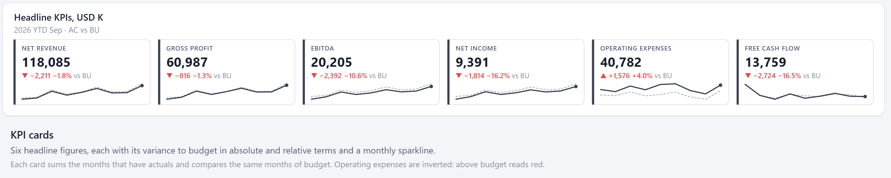

# IBCS KPI Cards

IBCS KPI cards with variance and sparkline.

Used in the report on: Page 14 (KPI cards).

## Install

In Power BI Desktop: **Visualizations > ... > Import a visual from a file**, then pick `ibcsCards.pbiviz`.

## Data roles

| Role | Field type | Notes |
| --- | --- | --- |
| Period (`category`) | Grouping |  |
| Actual (one per card) (`ac`) | Measure |  |
| Comparison (same order) (`pm`) | Measure |  |

## Format options

- **Cards**: Unit, Text size, Comparison label, Cards where up is bad (pipe separated), Sparkline

## Details

- Version 1.0.0.2, visual GUID `ibcsCardsFEEACD80288B404D9FA2AD5E9F82B305`
- No special privileges (no network access)
- Author: Faizaan, Contact@faizaan.me
- Licence: MIT, see the repository `LICENSE`
