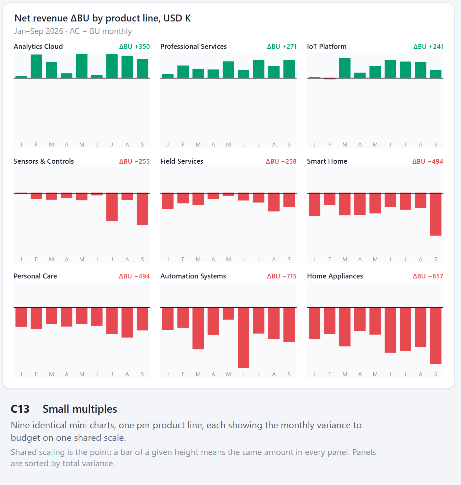

# IBCS Small Multiples

IBCS small multiples on one shared scale.

Used in the report on: Page 5 (C13).

## Install

In Power BI Desktop: **Visualizations > ... > Import a visual from a file**, then pick `ibcsMultiples.pbiviz`.

## Data roles

| Role | Field type | Notes |
| --- | --- | --- |
| Panels (`panel`) | Grouping |  |
| Period (`category`) | Grouping |  |
| Actual (AC) (`ac`) | Measure |  |
| Comparison (`pm`) | Measure |  |

## Format options

- **Chart**: Show, Unit, Panels per row (0 = auto), Text size, Data labels, Invert variance colours, Comparison label

## Details

- Version 1.0.0.3, visual GUID `ibcsMultiplesB9599ECA142C47BCA9DEA2F6B38565CD`
- No special privileges (no network access)
- Author: Faizaan, Contact@faizaan.me
- Licence: MIT, see the repository `LICENSE`
