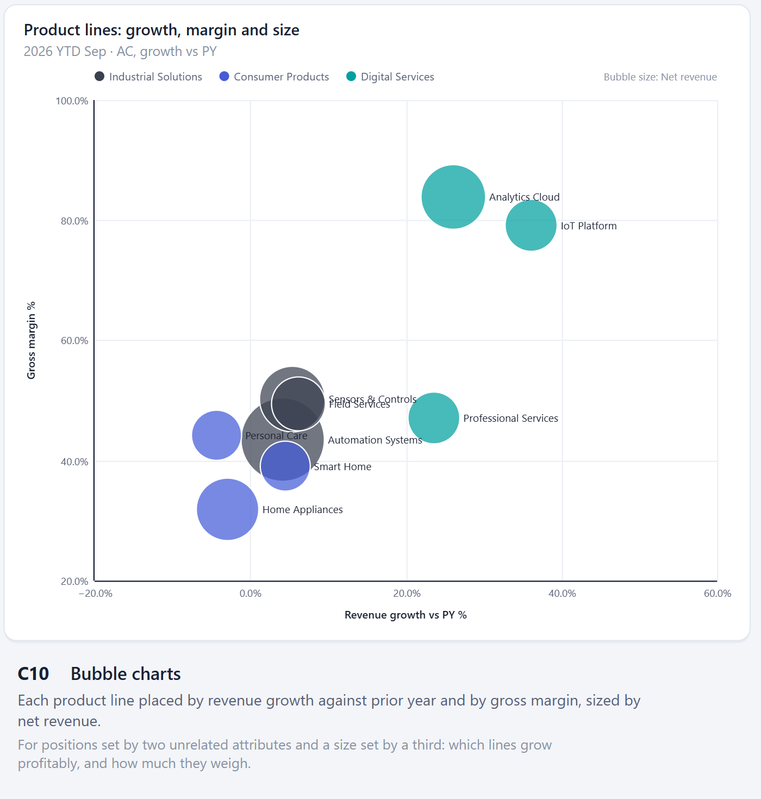

# IBCS Scatter Chart

IBCS scattergram and bubble chart with iso-lines.

Used in the report on: Page 4 (C09, C10).

## Install

In Power BI Desktop: **Visualizations > ... > Import a visual from a file**, then pick `ibcsScatter.pbiviz`.

## Data roles

| Role | Field type | Notes |
| --- | --- | --- |
| Points (one or two columns) (`category`) | Grouping |  |
| Series (colour) (`series`) | Grouping |  |
| X value (`x`) | Measure |  |
| Y value (`y`) | Measure |  |
| Bubble size (`size`) | Measure | Optional. When bound the chart becomes a bubble chart. |

## Format options

- **Chart**: X format, Y format, X axis title, Y axis title, Iso-lines (x times y constant), Iso-line label prefix, Point labels, Text size

## Details

- Version 1.0.0.2, visual GUID `ibcsScatter654A432B7AA9479EAC18E9430E54469C`
- No special privileges (no network access)
- Author: Faizaan, Contact@faizaan.me
- Licence: MIT, see the repository `LICENSE`
