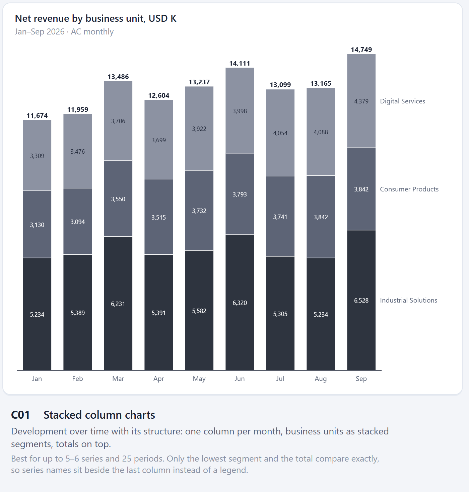

# IBCS Series Chart

IBCS stacked columns, stacked bars, lines, areas and dot plots.

Used in the report on: Pages 3, 12 and 13 (C01, C02, C07, C08, dot plot).

## Install

In Power BI Desktop: **Visualizations > ... > Import a visual from a file**, then pick `ibcsSeries.pbiviz`.

## Data roles

| Role | Field type | Notes |
| --- | --- | --- |
| Category (time or structure) (`category`) | Grouping |  |
| Series (stack / lines) (`series`) | Grouping |  |
| Value (`measure`) | Measure |  |

## Format options

- **Chart**: Type, Unit, Text size, Data labels, Sort structure by total (bars, dots)

## Details

- Version 1.0.0.2, visual GUID `ibcsSeries4168E0C8777C41E3A2D1AAA6638B5D25`
- No special privileges (no network access)
- Author: Faizaan, Contact@faizaan.me
- Licence: MIT, see the repository `LICENSE`
